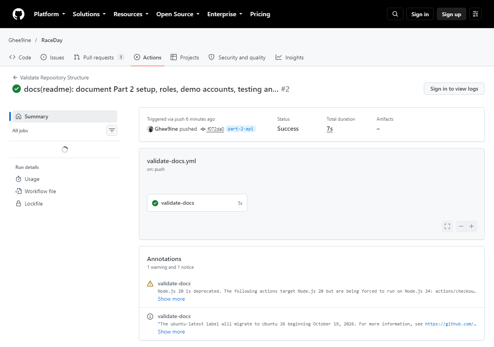
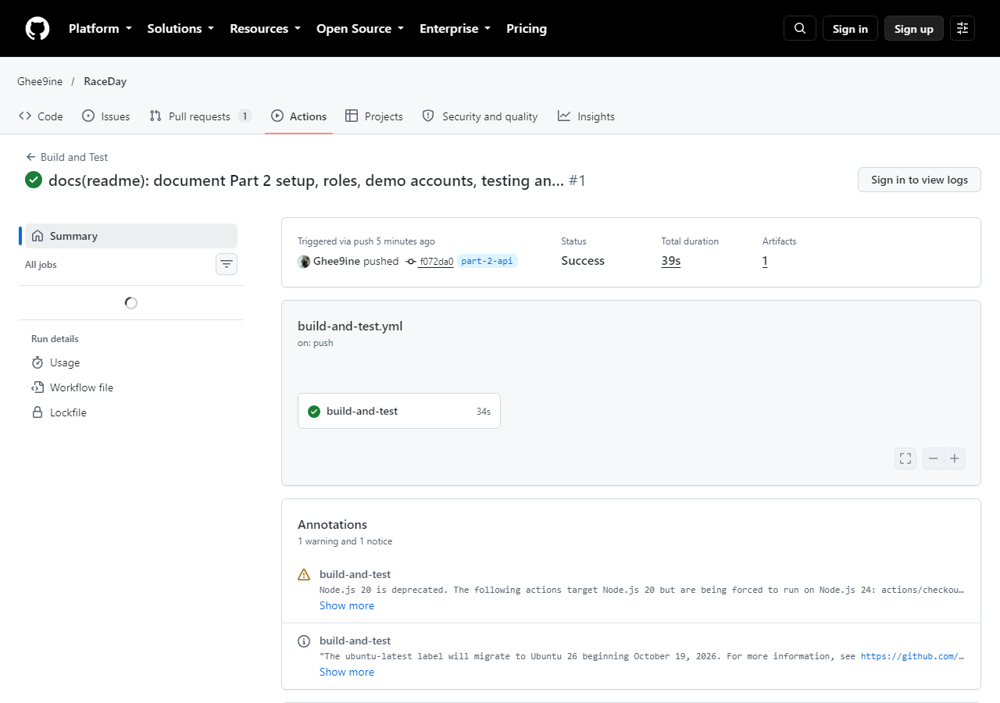
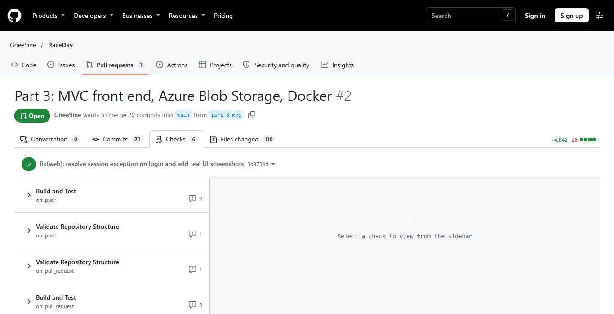

# RaceDay - Event Management System

[](https://github.com/Ghee9ine/RaceDay/actions/workflows/validate-docs.yml)
[](https://github.com/Ghee9ine/RaceDay/actions/workflows/build-and-test.yml)

RaceDay is a full-stack event management platform for the South African road running, walking, and cycling community. Event Organisers create and manage events, categories, and participant results. Participants browse upcoming events, enter a category, track their personal results, and check route and weather information before race day.

This repository holds a three-part Portfolio of Evidence (PROG6212 - Programming 2B):

| Part | Scope | Status |
|---|---|---|
| 1 | System planning: ERD, API endpoint plan, SQL Server script | Complete |
| 2 | RESTful API in C# (ASP.NET Core + EF Core Code-First), session auth, Swagger, unit tests, CI/CD | Complete (branch `part-2-api`) |
| 3 | ASP.NET Core MVC front end, Azure Blob Storage, Docker | Complete (branch `part-3-mvc`) |

## Roles

- **Organiser**: creates, edits, and deletes their own events; manages categories under those events; captures and corrects participant results; views all enrolments for their events.
- **Participant**: registers an account; browses published events; enters an event by selecting a category; views and cancels their own enrolments; tracks their own result history; checks route and weather information.

How roles are enforced: after login, the API stores the user's `UserId` and `Role` in a server-side session. The browser only holds the `.RaceDay.Session` cookie, which carries no user data. A custom `SessionAuthenticationHandler` turns the session into a `ClaimsPrincipal`, so controllers use `[Authorize(Roles = "Organiser")]` / `[Authorize(Roles = "Participant")]`. Services then check ownership: an organiser can only change their own events, categories, routes, and results. Unauthenticated calls return 401, and the wrong role or wrong owner returns 403.

## Repository structure

```
RaceDay.sln
src/RaceDay.Api/            ASP.NET Core Web API (Controllers, Services, Data, Dtos, Auth, Migrations)
src/RaceDay.Api/Dockerfile  Multi-stage build for the API container
src/RaceDay.Web/            ASP.NET Core MVC front end (Controllers, Services/Api, Models/Api, ViewModels, Views)
src/RaceDay.Web/Dockerfile  Multi-stage build for the Web container
tests/RaceDay.Api.Tests/    xUnit tests (WebApplicationFactory + SQLite in-memory)
tests/RaceDay.Web.Tests/    xUnit tests (session filters, cookie forwarding, API client error mapping)
docs/                       Part 1 planning documents (ERD, endpoint plan, SQL script)
.github/workflows/          CI: repository structure validation + build, test and docker-build
docker-compose.yml          Single-command local run: SQL Server + API + Web
.env.example                Template for the .env file docker-compose.yml reads (never commit the real .env)
```

## Part 1 - Planning documents (/docs)

| File | Description |
|---|---|
| [erd.png](docs/erd.png) | Entity Relationship Diagram: 7 entities, all primary/foreign keys and cardinalities labelled. |
| [erd-source.mmd](docs/erd-source.mmd) | Mermaid source used to generate `erd.png`. |
| [api-endpoint-plan.md](docs/api-endpoint-plan.md) | Every endpoint: method, route, description, role required, request body, expected response. |
| [raceday-schema.sql](docs/raceday-schema.sql) | SQL Server script that creates the schema and seeds sample data. |
| [ef-generated-schema.sql](docs/ef-generated-schema.sql) | Script generated from the EF Core migration, kept as proof that the Code-First model matches the Part 1 schema. |

**The SQL script matches the ERD exactly**: same 7 entities, keys, constraints, and relationships.

### Data model summary

- `Users` holds both Organisers and Participants, distinguished by a `Role` column.
- `Events` belongs to one Organiser (one-to-many).
- `Categories` belongs to one Event (one-to-many), e.g. "21km Half Marathon", with an optional age group.
- `Routes` belongs to one Category (one-to-one): start/end point, elevation, map link.
- `WeatherSnapshots` belongs to one Event (one-to-many): recorded forecast history.
- `Enrolments` is the junction table resolving the many-to-many relationship between Participants and Categories. It carries the bib number, enrolment date, and status.
- `Results` belongs to one Enrolment (one-to-one) and records which Organiser captured it.

### Design decisions

- **Sessions, not JWT.** The brief requires session management, so login creates a server-side session that stores the user ID and role. The original plan's JWT wording was replaced, and a `POST /api/auth/logout` endpoint was added.
- **Distance lives on Categories.** One event offers several distances (e.g. 87km and 21.1km), so distance is stored per category. Event responses include a computed `distancesKm` list. "Location" is `Venue` + `Province`, and "event type" is `DisciplineType`.
- **Age groups.** `Categories.AgeGroup` (e.g. Open, Under 20, Senior, Veteran) supports age categories alongside distance categories.
- **Image URLs, uploaded in Part 3.** `Events.BannerImageUrl` and `Users.ProfilePictureUrl` are nullable columns added in Part 1. The upload endpoints themselves (Azure Blob Storage through the API) were added in Part 3 - see [docs/api-endpoint-plan.md](docs/api-endpoint-plan.md), rows marked "Added in Part 3".
- **Enrolment cancellation is a soft delete** (`Status = Cancelled`), which keeps history. Re-entering the same category reactivates the record.
- **Bib numbers** are generated as `C{categoryId:00}-{enrolmentId:00000}`, which is unique by construction.
- **Organiser dashboard.** `GET /api/events/mine` returns the organiser's events in any status, with enrolment counts.
- **Weather is served from recorded `WeatherSnapshots`.** Live forecast retrieval is out of scope for Part 2.

### Running the SQL script (Part 1 artefact)

Requires SQL Server (Express, Developer, or LocalDB) and SSMS or `sqlcmd`.

```
sqlcmd -S "(localdb)\MSSQLLocalDB" -i docs/raceday-schema.sql
```

The script drops and recreates `RaceDayDb`, so it is safe to re-run. Seed data: 2 Organisers, 2 Participants, 4 Events (3 completed, 1 upcoming), categories for every event, routes, weather snapshots, enrolments, and results. Seed passwords are real hashes (see demo accounts below).

## Part 2 - RaceDay API

### Prerequisites

- Visual Studio 2022+ (ASP.NET and web development workload) or the .NET SDK matching `global.json`
- SQL Server LocalDB (installed with Visual Studio) or SQL Server Express
- EF Core CLI: `dotnet tool install --global dotnet-ef`

### Setup and run

```bash
git clone https://github.com/Ghee9ine/RaceDay.git
cd RaceDay
git checkout part-2-api
dotnet restore
dotnet ef database update --project src/RaceDay.Api   # creates RaceDayDb with Code-First migrations
dotnet run --project src/RaceDay.Api                   # seeds demo data on first run (Development)
```

Open `https://localhost:<port>/swagger` (the port is printed in the console).

The connection string is `DefaultConnection` in `src/RaceDay.Api/appsettings.Development.json` and points to `(localdb)\MSSQLLocalDB`. Note: if you previously created `RaceDayDb` with the Part 1 SQL script, drop it first (`DROP DATABASE RaceDayDb;`), because migrations expect to create it.

### Using Swagger with sessions

1. Run `POST /api/auth/login` with a demo account below.
2. The browser stores the `.RaceDay.Session` cookie, and every later "Try it out" call sends it automatically.
3. Run `POST /api/auth/logout` to end the session.

### Demo accounts

All seed users share the password `RaceDay@2026`.

| Name | Email | Role |
|---|---|---|
| Thandiwe Mokoena | thandiwe.mokoena@raceday.co.za | Organiser |
| Johan van der Merwe | johan.vdm@raceday.co.za | Organiser |
| Lindiwe Dlamini | lindiwe.dlamini@example.com | Participant |
| Ryan Naidoo | ryan.naidoo@example.com | Participant |

### Endpoints

The full list, with roles, bodies, and responses, is in [docs/api-endpoint-plan.md](docs/api-endpoint-plan.md). Resource groups: Authentication, User Profile, Events, Categories, Event Enrolments, Results, Race-Day Preparation (Routes & Weather), and Uploads (added in Part 3) - 29 endpoints in total, all documented and grouped the same way in Swagger.

### Tests

```bash
dotnet test tests/RaceDay.Api.Tests/RaceDay.Api.Tests.csproj
```

xUnit tests run the real API in memory through `WebApplicationFactory<Program>`, backed by a SQLite in-memory database (unique indexes, CHECK constraints and foreign keys all still enforced). They cover registration, login and logout; unauthenticated access (401); wrong-role and wrong-owner access (403); organiser event and category management; participant enrolment (including that the participant-event-category link is stored, capacity limits, and reactivation after cancelling); result capture, correction, history and the leaderboard; and, added in Part 3, banner/profile-picture upload validation (size limit, declared-vs-actual content type, a renamed executable rejected by its magic bytes, ownership, and old-blob cleanup on replacement) against a `FakeBlobStorageService`. 52 tests, all passing.

> Run the two test projects separately (`RaceDay.Api.Tests` and `RaceDay.Web.Tests`) rather than `dotnet test` on the whole solution if you're on a memory-constrained machine - running both xUnit hosts in parallel can exhaust available memory and abort the build (`dotnet test RaceDay.sln` works fine with more RAM available).

## Part 3 - RaceDay Web (MVC front end)

### MVC architecture

`RaceDay.Web` is an ASP.NET Core MVC app that is **only ever an HTTP client of the API** - it has no `ProjectReference` to `RaceDay.Api`, no EF Core package, and no SQL client package (see `RaceDay.Web.csproj`'s own comment). Everything it knows about the API's shape lives in `Models/Api/` as plain `record` DTOs, deliberately duplicated from the API's own DTOs rather than shared, so that a wire-format change on one side has to be noticed and matched on the other, instead of silently compiling through a shared reference.

A few deliberate design choices worth knowing before reading the code:

- **Two separate sessions.** The API has its own server-side session (`.RaceDay.Session`, unchanged from Part 2). `RaceDay.Web` has a *second*, separate session (`.RaceDay.Web.Session`) that stores the signed-in user's identity (`UserId`/`Role`/`FullName`/`ProfilePictureUrl`) plus a forwarded copy of the API's own session cookie value, under `SessionKeys.ApiSessionCookie`.
- **Cookie forwarding without leaking between users.** `RaceDayApiClient`'s `HttpClient` is registered with `HttpClientHandler { UseCookies = false }`, because that `HttpClientHandler` is pooled and shared across every concurrent user of the app - a shared `CookieContainer` would leak one user's `.RaceDay.Session` value into a completely different user's request. Instead, `ApiSessionCookieHandler` (a `DelegatingHandler`) reads the *current* request's own MVC session fresh on every outgoing call and attaches only that user's own cookie.
- **`ApiResult<T>`, not exceptions, for expected outcomes.** Every `RaceDayApiClient` method returns an `ApiResult<T>` for 400/403/404/409 - a controller inspects `.Success`/`.ErrorMessage`/`.ValidationErrors` and decides what to show. The one exception that *is* thrown is `ApiUnauthorizedException`, raised only when the API returns 401 for a request the MVC session believed was already authenticated (meaning the API's own session store lost its data, e.g. a restart) - a global `IExceptionFilter` catches it, clears the MVC session, and redirects to login with "your session expired." A login attempt's own 401 (wrong password) is handled separately and never throws, since that is an entirely ordinary, expected outcome.
- **Session-based route guards, not `[Authorize]`.** `RaceDay.Web` has no cookie-auth middleware of its own; `[RequireLogin]` and `[RequireRole("Organiser"|"Participant")]` are plain `ActionFilterAttribute`s that read the same MVC session `SessionUser` does, and redirect to Login or AccessDenied accordingly.
- **CDN-hosted front-end libraries.** Bootstrap 5, Bootstrap Icons and jQuery Validation Unobtrusive are loaded from jsDelivr/code.jquery.com/cdnjs in `_Layout.cshtml`, rather than vendored into `wwwroot/lib` via LibMan. This is a deliberate time-saving deviation from the ASP.NET Core MVC template's usual setup - documented here rather than left unexplained.

### Pages

| Area | Pages |
|---|---|
| Public | Home (hero + quick filter), Events (filterable list), Event details (banner, weather, categories, enrol), category leaderboard |
| Account | Register, Login, Logout, Access denied |
| Shared (any logged-in user) | Profile (edit details, upload profile picture) |
| Participant | My Enrolments (cancel), My Results |
| Organiser | Dashboard (KPI tiles, upcoming events, recent events), My Events (CRUD + banner upload + live preview), Categories (CRUD) + Route per category, Enrolments roster (per event, category filter), Results capture (per event, mark event Completed) |

One known, disclosed gap: there is no "edit an already-captured result" page. The API's roster endpoint (`GET /api/events/{id}/enrolments`) never returns a result's own id, only `CaptureResultAsync` (create) and the public leaderboard (read-only) are wired up - editing a captured result would need either a new API endpoint or the roster DTO to carry the result id back, neither of which Section 4 of the brief asked for.

### Azure Blob Storage (uploads)

Both upload endpoints live on the **API**, not the Web app - the Web app only ever forwards the file it received to the API as multipart form data; it never talks to Azure directly.

- `POST /api/events/{id}/banner` - Organiser who owns the event, 5MB limit, JPEG/PNG/WebP validated by actual file signature (not just the declared `Content-Type`), blob path `events/{eventId}/{guid}.{ext}`.
- `POST /api/users/me/profile-picture` - any logged-in user, same limits and validation, blob path `users/{userId}/{guid}.{ext}`.

Locally, set the connection string with user-secrets so it's never written to a file at all:

```bash
dotnet user-secrets set "ConnectionStrings:BlobStorage" "<your Azure Storage connection string>" --project src/RaceDay.Api
```

Without it, uploads return `503 Service Unavailable` (via `NotConfiguredBlobStorageService`) and everything else in the app works normally - this is what a fresh clone and the test suite both do by default.

**One manual step the student does in the Azure Portal, not in code:** the container (`raceday-images` by default) needs its public access level set to "Blob" so the stored URLs are directly viewable in `` tags without a SAS token. Azure Storage accounts increasingly disable anonymous blob access by default - enable it at the storage account level first if the container-level setting is greyed out.

### Running locally without Docker

Two terminals, from the repo root:

```bash
dotnet run --project src/RaceDay.Api    # https://localhost:7275 (Swagger at /swagger)
dotnet run --project src/RaceDay.Web    # https://localhost:7180
```

`src/RaceDay.Web/appsettings.json`'s `Api:BaseUrl` must point at wherever the API is actually running - `https://localhost:7275/` is already the default to match `src/RaceDay.Api/Properties/launchSettings.json`.

### Running with Docker (single command)

```bash
cp .env.example .env     # then edit SQL_SA_PASSWORD (and BLOB_STORAGE_CONNECTION_STRING if you have one)
docker compose up --build
```

- API: `http://localhost:8080` (Swagger UI is enabled in the container via `Swagger__Enabled=true`)
- Web: `http://localhost:8081`
- SQL Server: `localhost:1433` (for connecting with SSMS/Azure Data Studio if you want to look at the data directly)

The API container runs its EF Core migrations and seeds demo data automatically on first start (`Database__MigrateOnStartup`/`Database__SeedDemoData`, with a 10-attempt retry loop for the SQL Server container's own startup time). Data Protection keys persist to named volumes (`raceday-api-keys`/`raceday-web-keys`), so restarting a container doesn't silently log every user out. `docker compose down -v` removes the named volumes too, for a genuinely clean slate.

**Not verified in this submission's build environment:** `docker build`/`docker compose up` have not actually been executed here (no Docker daemon available, and disk space too tight for the SQL Server image) - the Dockerfiles and compose file were written and carefully checked by reading, not by a live run. The CI `docker-build` job (see CI/CD below) builds both images on every push, which is the first real verification they'll get; the student should also run the command above locally at least once before recording the video.

### Tests (RaceDay.Web.Tests)

```bash
dotnet test tests/RaceDay.Web.Tests/RaceDay.Web.Tests.csproj
```

Unit tests, no real HTTP or database involved: `RequireRoleAttribute`'s three outcomes (no session, wrong role, matching role), `ApiSessionCookieHandler` attaching the right per-user cookie and never leaking one user's cookie into another's request, and `RaceDayApiClient`'s error mapping (both of the API's error body shapes, and 401 escalating to `ApiUnauthorizedException`) plus `LoginAsync`'s `Set-Cookie` extraction into the MVC session. 11 tests, all passing.

## Database

- **Code-First migrations** (`src/RaceDay.Api/Migrations`) are what actually creates and updates the database the API runs against - `dotnet ef database update`.
- `docs/raceday-schema.sql` is the Part 1 artefact: a hand-written script describing the same schema, useful for reviewing the design independently of EF Core.
- `docs/ef-generated-schema.sql` is generated straight from the migration (`dotnet ef migrations script`) and kept as a parity check against the Part 1 script.
- To reset: drop `RaceDayDb` (`sqlcmd -S "(localdb)\MSSQLLocalDB" -Q "DROP DATABASE RaceDayDb;"`) and run `dotnet ef database update` again; the seeder repopulates it on the next `dotnet run` in Development.

## CI/CD

| Workflow | What it does |
|---|---|
| [validate-docs.yml](.github/workflows/validate-docs.yml) | Checks the `/docs` files, README, solution, and project folders (Part 1/2/3) exist, that the SQL script has no placeholders, and fails the build if a real `.env` file or a hardcoded `AccountKey=` connection string is ever committed. |
| [build-and-test.yml](.github/workflows/build-and-test.yml) | Restores, builds (Release) - now covering `RaceDay.Web` too since it's in the solution - and runs all tests on every push, uploads the test results, then (`docker-build` job) builds both Dockerfiles with `docker/build-push-action`, `push: false`, no registry login. |

Part 1 green build:



Part 2 green build:



Part 3 green build (including the `docker-build` job):



## Video walkthroughs (unlisted YouTube)

- Part 1: _add link_
- Part 2: _add link_
- Part 3: _add link_

The Part 2 video shows: the running API, every endpoint group in Swagger, register/login/logout for both roles, a rejected wrong-role request, the code structure (controllers, services, EF configuration, session handler), and the tests passing locally and in GitHub Actions. The Part 3 video should show: the MVC app running (either `dotnet run` or `docker compose up`), a full Organiser walkthrough (create an event with a banner upload, add a category, view the enrolments roster, capture a result), a full Participant walkthrough (browse, enrol, view My Enrolments/My Results, upload a profile picture), the session-expiry redirect, the code structure (`Services/Api/RaceDayApiClient`, the session/cookie-forwarding pieces, the Dockerfiles), and both test suites passing locally and in GitHub Actions (including the `docker-build` job). The voiceover for every part is the author's own voice (no AI-generated voices).

## AI tool disclosure

AI assistance (Claude) was used in Part 1 to help draft the initial ERD structure, endpoint plan table, and SQL script skeleton, and to render the ERD from Mermaid source. In Part 2, it was used extensively to help close the Part 1 gaps, implement the API (entities, EF configuration, services, controllers, session authentication, Swagger, error handling), write the test suite, and set up CI - with each piece verified by actually running it (build, live HTTP requests against a running instance, and the automated test suite) rather than assumed correct, and several real bugs it surfaced along the way fixed in the same pass (a SQL Server-only column type and ORDER BY clause that broke under SQLite, and a record-validation gotcha in ASP.NET Core). In Part 3, it was used to add Azure Blob Storage to the API (upload endpoints, magic-byte image validation, container-friendly startup config) and to build the entire `RaceDay.Web` MVC front end (session/cookie-forwarding architecture, the typed API client, every page, the Web test suite, both Dockerfiles, `docker-compose.yml`, and CI updates) - verified by `dotnet build`/`dotnet test` actually passing (52 API tests, 11 Web tests) on every commit, with one real design mistake caught and fixed along the way (the category leaderboard was first wired up behind an Organiser-only login, which contradicted the API's own `[AllowAnonymous]` on that endpoint, and was moved to the public controller in its own commit). Docker's actual build/run was **not** executed in the environment this was built in (no Docker daemon, insufficient disk space) - the student must run `docker compose up --build` themselves at least once before recording the Part 3 video, to confirm it genuinely behaves the same as the non-Docker run. The author is responsible for reviewing, running, and understanding every part of this submission, and can explain each design decision and each line of code in the video walkthroughs.
