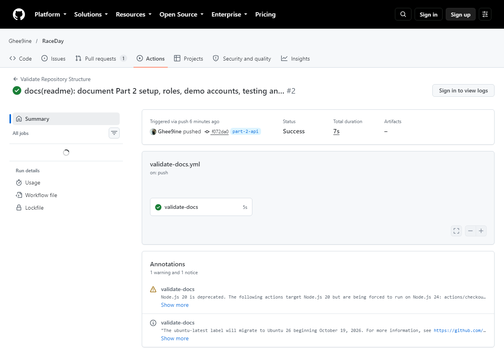
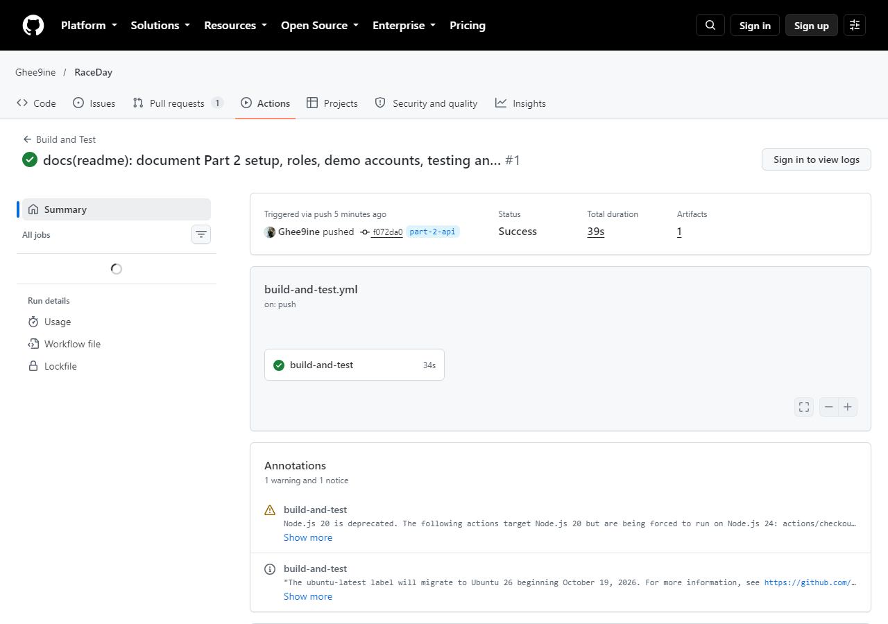

# RaceDay - Event Management System

[](https://github.com/Ghee9ine/RaceDay/actions/workflows/validate-docs.yml)
[](https://github.com/Ghee9ine/RaceDay/actions/workflows/build-and-test.yml)

RaceDay is a full-stack event management platform for the South African road running, walking, and cycling community. Event Organisers create and manage events, categories, and participant results. Participants browse upcoming events, enter a category, track their personal results, and check route and weather information before race day.

This repository holds a three-part Portfolio of Evidence (PROG6212 - Programming 2B):

| Part | Scope | Status |
|---|---|---|
| 1 | System planning: ERD, API endpoint plan, SQL Server script | Complete |
| 2 | RESTful API in C# (ASP.NET Core + EF Core Code-First), session auth, Swagger, unit tests, CI/CD | Complete (branch `part-2-api`) |
| 3 | ASP.NET Core MVC front end, Azure Blob Storage, Docker | Upcoming |

## Roles

- **Organiser**: creates, edits, and deletes their own events; manages categories under those events; captures and corrects participant results; views all enrolments for their events.
- **Participant**: registers an account; browses published events; enters an event by selecting a category; views and cancels their own enrolments; tracks their own result history; checks route and weather information.

How roles are enforced: after login, the API stores the user's `UserId` and `Role` in a server-side session. The browser only holds the `.RaceDay.Session` cookie, which carries no user data. A custom `SessionAuthenticationHandler` turns the session into a `ClaimsPrincipal`, so controllers use `[Authorize(Roles = "Organiser")]` / `[Authorize(Roles = "Participant")]`. Services then check ownership: an organiser can only change their own events, categories, routes, and results. Unauthenticated calls return 401, and the wrong role or wrong owner returns 403.

## Repository structure

```
RaceDay.sln
src/RaceDay.Api/            ASP.NET Core Web API (Controllers, Services, Data, Dtos, Auth, Migrations)
tests/RaceDay.Api.Tests/    xUnit tests (WebApplicationFactory + SQLite in-memory)
docs/                       Part 1 planning documents (ERD, endpoint plan, SQL script)
.github/workflows/          CI: repository structure validation + build and test
```

## Part 1 - Planning documents (/docs)

| File | Description |
|---|---|
| [erd.png](docs/erd.png) | Entity Relationship Diagram: 7 entities, all primary/foreign keys and cardinalities labelled. |
| [erd-source.mmd](docs/erd-source.mmd) | Mermaid source used to generate `erd.png`. |
| [api-endpoint-plan.md](docs/api-endpoint-plan.md) | Every endpoint: method, route, description, role required, request body, expected response. |
| [raceday-schema.sql](docs/raceday-schema.sql) | SQL Server script that creates the schema and seeds sample data. |
| [ef-generated-schema.sql](docs/ef-generated-schema.sql) | Script generated from the EF Core migration, kept as proof that the Code-First model matches the Part 1 schema. |

**The SQL script matches the ERD exactly**: same 7 entities, keys, constraints, and relationships.

### Data model summary

- `Users` holds both Organisers and Participants, distinguished by a `Role` column.
- `Events` belongs to one Organiser (one-to-many).
- `Categories` belongs to one Event (one-to-many), e.g. "21km Half Marathon", with an optional age group.
- `Routes` belongs to one Category (one-to-one): start/end point, elevation, map link.
- `WeatherSnapshots` belongs to one Event (one-to-many): recorded forecast history.
- `Enrolments` is the junction table resolving the many-to-many relationship between Participants and Categories. It carries the bib number, enrolment date, and status.
- `Results` belongs to one Enrolment (one-to-one) and records which Organiser captured it.

### Design decisions

- **Sessions, not JWT.** The brief requires session management, so login creates a server-side session that stores the user ID and role. The original plan's JWT wording was replaced, and a `POST /api/auth/logout` endpoint was added.
- **Distance lives on Categories.** One event offers several distances (e.g. 87km and 21.1km), so distance is stored per category. Event responses include a computed `distancesKm` list. "Location" is `Venue` + `Province`, and "event type" is `DisciplineType`.
- **Age groups.** `Categories.AgeGroup` (e.g. Open, Under 20, Senior, Veteran) supports age categories alongside distance categories.
- **Image URLs reserved for Part 3.** `Events.BannerImageUrl` and `Users.ProfilePictureUrl` are nullable now. The upload endpoints are listed in the plan as "Implemented in Part 3" (Azure Blob Storage through the API).
- **Enrolment cancellation is a soft delete** (`Status = Cancelled`), which keeps history. Re-entering the same category reactivates the record.
- **Bib numbers** are generated as `C{categoryId:00}-{enrolmentId:00000}`, which is unique by construction.
- **Organiser dashboard.** `GET /api/events/mine` returns the organiser's events in any status, with enrolment counts.
- **Weather is served from recorded `WeatherSnapshots`.** Live forecast retrieval is out of scope for Part 2.

### Running the SQL script (Part 1 artefact)

Requires SQL Server (Express, Developer, or LocalDB) and SSMS or `sqlcmd`.

```
sqlcmd -S "(localdb)\MSSQLLocalDB" -i docs/raceday-schema.sql
```

The script drops and recreates `RaceDayDb`, so it is safe to re-run. Seed data: 2 Organisers, 2 Participants, 4 Events (3 completed, 1 upcoming), categories for every event, routes, weather snapshots, enrolments, and results. Seed passwords are real hashes (see demo accounts below).

## Part 2 - RaceDay API

### Prerequisites

- Visual Studio 2022+ (ASP.NET and web development workload) or the .NET SDK matching `global.json`
- SQL Server LocalDB (installed with Visual Studio) or SQL Server Express
- EF Core CLI: `dotnet tool install --global dotnet-ef`

### Setup and run

```bash
git clone https://github.com/Ghee9ine/RaceDay.git
cd RaceDay
git checkout part-2-api
dotnet restore
dotnet ef database update --project src/RaceDay.Api   # creates RaceDayDb with Code-First migrations
dotnet run --project src/RaceDay.Api                   # seeds demo data on first run (Development)
```

Open `https://localhost:<port>/swagger` (the port is printed in the console).

The connection string is `DefaultConnection` in `src/RaceDay.Api/appsettings.Development.json` and points to `(localdb)\MSSQLLocalDB`. Note: if you previously created `RaceDayDb` with the Part 1 SQL script, drop it first (`DROP DATABASE RaceDayDb;`), because migrations expect to create it.

### Using Swagger with sessions

1. Run `POST /api/auth/login` with a demo account below.
2. The browser stores the `.RaceDay.Session` cookie, and every later "Try it out" call sends it automatically.
3. Run `POST /api/auth/logout` to end the session.

### Demo accounts

All seed users share the password `RaceDay@2026`.

| Name | Email | Role |
|---|---|---|
| Thandiwe Mokoena | thandiwe.mokoena@raceday.co.za | Organiser |
| Johan van der Merwe | johan.vdm@raceday.co.za | Organiser |
| Lindiwe Dlamini | lindiwe.dlamini@example.com | Participant |
| Ryan Naidoo | ryan.naidoo@example.com | Participant |

### Endpoints

The full list, with roles, bodies, and responses, is in [docs/api-endpoint-plan.md](docs/api-endpoint-plan.md). Resource groups: Authentication, User Profile, Events, Categories, Event Enrolments, Results, and Race-Day Preparation (Routes & Weather) - 27 endpoints in total, all documented and grouped the same way in Swagger.

### Tests

```bash
dotnet test
```

xUnit tests run the real API in memory through `WebApplicationFactory<Program>`, backed by a SQLite in-memory database (unique indexes, CHECK constraints and foreign keys all still enforced). They cover registration, login and logout; unauthenticated access (401); wrong-role and wrong-owner access (403); organiser event and category management; participant enrolment (including that the participant-event-category link is stored, capacity limits, and reactivation after cancelling); and result capture, correction, history and the leaderboard. 41 tests, all passing.

## Database

- **Code-First migrations** (`src/RaceDay.Api/Migrations`) are what actually creates and updates the database the API runs against - `dotnet ef database update`.
- `docs/raceday-schema.sql` is the Part 1 artefact: a hand-written script describing the same schema, useful for reviewing the design independently of EF Core.
- `docs/ef-generated-schema.sql` is generated straight from the migration (`dotnet ef migrations script`) and kept as a parity check against the Part 1 script.
- To reset: drop `RaceDayDb` (`sqlcmd -S "(localdb)\MSSQLLocalDB" -Q "DROP DATABASE RaceDayDb;"`) and run `dotnet ef database update` again; the seeder repopulates it on the next `dotnet run` in Development.

## CI/CD

| Workflow | What it does |
|---|---|
| [validate-docs.yml](.github/workflows/validate-docs.yml) | Checks the `/docs` files, README, solution, and project folders exist, and that the SQL script has no placeholders. |
| [build-and-test.yml](.github/workflows/build-and-test.yml) | Restores, builds (Release), and runs all tests on every push, then uploads the test results. |

Part 1 green build:



Part 2 green build:



## Video walkthroughs (unlisted YouTube)

- Part 1: _add link_
- Part 2: _add link_

The Part 2 video shows: the running API, every endpoint group in Swagger, register/login/logout for both roles, a rejected wrong-role request, the code structure (controllers, services, EF configuration, session handler), and the tests passing locally and in GitHub Actions. The voiceover is the author's own voice (no AI-generated voices).

## AI tool disclosure

AI assistance (Claude) was used in Part 1 to help draft the initial ERD structure, endpoint plan table, and SQL script skeleton, and to render the ERD from Mermaid source. In Part 2, it was used extensively to help close the Part 1 gaps, implement the API (entities, EF configuration, services, controllers, session authentication, Swagger, error handling), write the test suite, and set up CI - with each piece verified by actually running it (build, live HTTP requests against a running instance, and the automated test suite) rather than assumed correct, and several real bugs it surfaced along the way fixed in the same pass (a SQL Server-only column type and ORDER BY clause that broke under SQLite, and a record-validation gotcha in ASP.NET Core). The author is responsible for reviewing, running, and understanding every part of this submission, and can explain each design decision and each line of code in the video walkthroughs.
